# portal-met-bridge

**Meticulous & Belka Portal conductivity data visualization & analysis.** A local web app that visualizes and analyzes the data produced by a **Meticulous** espresso machine and a **Belka Portal** conductivity sensor: it records the Portal's conductivity stream alongside each shot, integrates it against the cup weight, estimates TDS from a per-coffee refractometer calibration, hands the finished brew to **Beanconqueror**, and shows a machine dashboard (status, temperatures, profiles, statistics, device info, connectivity) in the style of the Home Assistant add-on.

It runs entirely on your machine: no account, no cloud, nothing leaves the LAN. Shots live in the browser's IndexedDB (use *Back up all* to export them).

> **Status: early, vibe-coded, tested on one machine and a simulated Portal.** The Meticulous side has run against a real machine. The Portal side has been exercised end-to-end in Chrome against a simulated Portal that speaks the documented protocol (`tests/e2e-portal.mjs`), but **not yet against a physical Portal** — the in-app *Connection check* exists so that the first person who does can see exactly which step succeeds or fails. See [How this was built](#how-this-was-built) and [Contributing](CONTRIBUTING.md) before relying on it. Issues and pull requests are welcome.


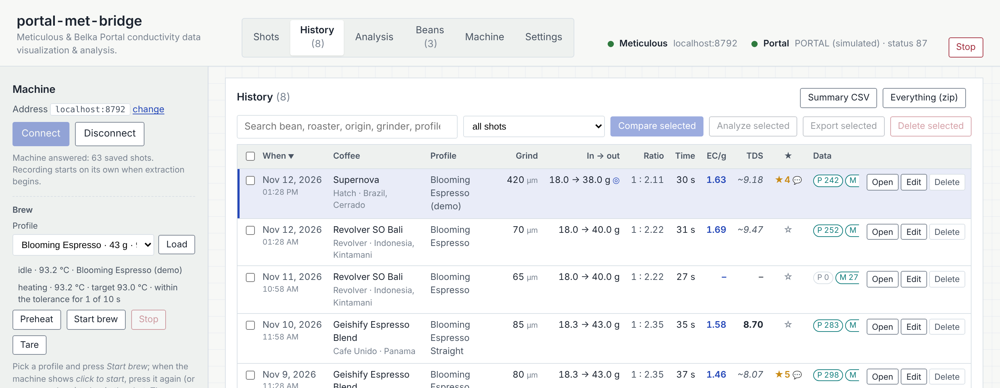
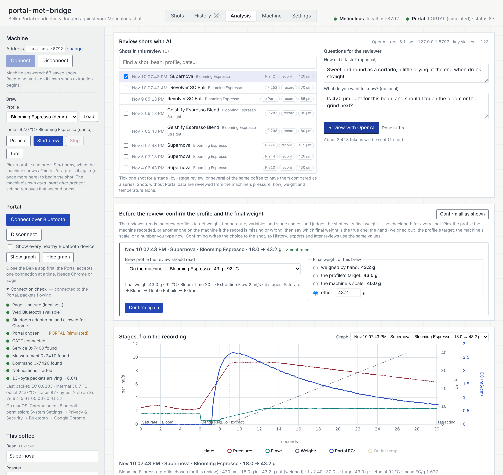
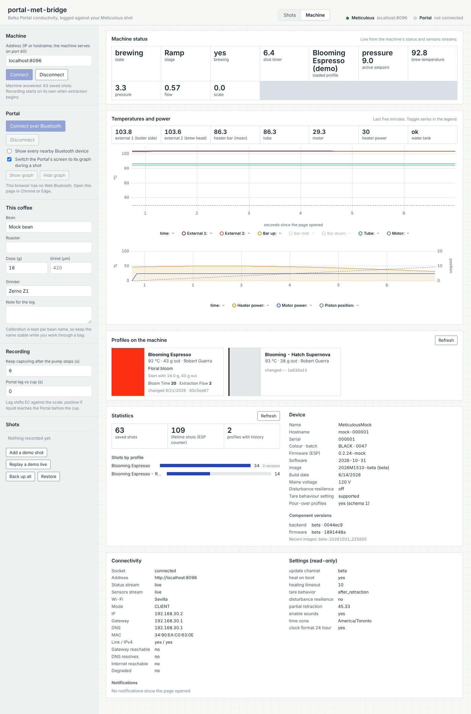
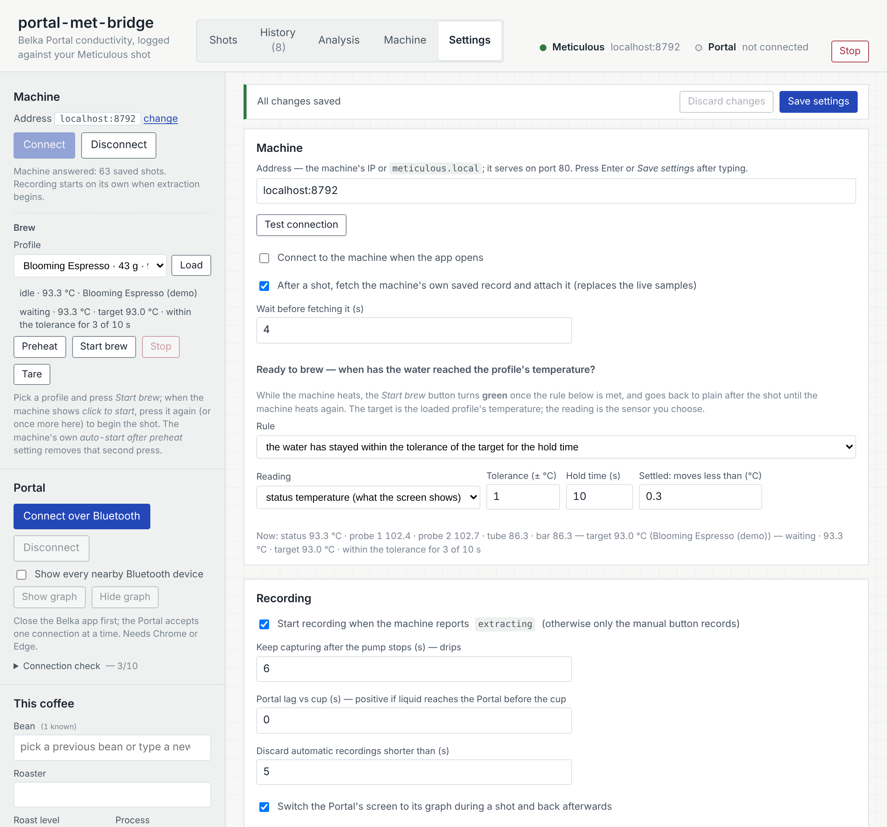

*The pictures are made by `npm run screenshots` (`tools/screenshots.mjs`) from the app running against the simulated Portal and the mock machine, with a week of seeded shots; the review text in the Analysis pictures comes from the test suite's mock endpoint, through the same request path a real provider uses.*

## What the Portal actually measures

The Portal is not a refractometer. Its stainless sensor reports **electrical conductivity (EC)** of the liquid passing through it, plus outlet temperature, over Bluetooth LE. EC tracks dissolved ions; a refractometer tracks everything dissolved; the ratio between the two depends on the coffee, the water and the sensor. So:

- the primary number here is **∫EC dm** — conductivity integrated over cumulative cup mass — and its normalisation, **mean EC per gram**;
- **TDS / EY are estimates**, produced only after you have saved refractometer readings for the same bean name. Each estimate carries uncertainty flags: *preliminary* below five reference shots, *extrapolated* outside the measured EC range, *unreliable* when the Portal missed part of the pour.

This follows the approach the Decenza project took for the Portal on Decent machines (mass-weighted EC, proportional `TDS = k × meanEC` with leave-one-out error, affine only when it clearly wins).

## Requirements

- macOS with **Chrome or Edge** (Web Bluetooth; Safari and Firefox do not have it).
- Node ≥ 18 *or* Python 3 to serve the folder. Web Bluetooth only works from a secure origin, and `http://localhost` qualifies — opening `index.html` as a file does not, and neither does a LAN address.
- A Meticulous on the same network. The machine serves its API on **port 80** (nginx in front of the backend; the backend's own 8080 is bound to localhost on the machine). The address field defaults to `127.0.0.1` as a placeholder — type your machine's LAN IP (the machine shows it under Settings → Network) or `meticulous.local`.
- Close the Belka app on your phone first: the Portal takes one Bluetooth connection at a time.

## Run it

```bash
git clone https://github.com/privaterra/portal-met-bridge.git
cd portal-met-bridge
./start.command        # or: node serve.mjs   /   python3 -m http.server 8787 --bind 127.0.0.1
```

`start.command` serves on `http://localhost:8787`, keeps the app's files in `~/Documents/portal-met-bridge` (Settings → Files and folders) and opens Chrome. You can also double-click it in Finder (first time: right-click → Open, since it is unsigned). After updating (`git pull`), just reload; if an older copy of the page is still open and complains about a *Start-up problem*, reload once with Shift held (⌘⇧R) so Chrome drops its cached scripts — from v0.8.1 every script is version-stamped so this does not recur.

**Without a terminal:** the [Releases](https://github.com/privaterra/portal-met-bridge/releases) page carries **Portal Met Bridge.app** for macOS (Node bundled; unzip, move to Applications, open — the first time via right-click → Open) and this repository doubles as a **Home Assistant app repository** for a Raspberry Pi 5 or any other Home Assistant machine, which then serves the page on your LAN and keeps the files in `/share/portal-met-bridge`. How both are built, published and installed is in [docs/PACKAGING.md](docs/PACKAGING.md) and, step by step for each release, [docs/RELEASING.md](docs/RELEASING.md); the Home Assistant steps are also in [homeassistant/portal_met_bridge/DOCS.md](homeassistant/portal_met_bridge/DOCS.md).

Then, in the app:

1. **Settings → Machine**: enter the machine's IP (or `meticulous.local`) and press *Test connection* — it answers with the machine's name, firmware and saved-shot count. Back on **Shots**, press *Connect*. The dot turns green when the socket.io stream is up.
2. **Portal** → Connect over Bluetooth → pick the Portal in Chrome's chooser. The live EC readout starts, and the **Connection check** under the button turns each step green: secure page, Web Bluetooth, adapter, device chosen, GATT, service `0x7400`, measurement `0x7410`, command `0x7420`, notifications, 13-byte packets with their rate and raw bytes. If a step fails it says which and why.
3. Fill in **This coffee**. Bean, roaster, origin and grinder are each a pick-list of what you have entered before (press ↓ in an empty field to see it, type to filter, or type something new — it is remembered for next time, most-used first). Picking a previous bean fills in its roaster, roast level, process and origin. Calibration is grouped by bean name. Typos can be pruned under Settings → Pick-lists.
4. Pull a shot. Recording starts when the machine reports `extracting`, continues for a few seconds after the pump stops (drips), then saves. About four seconds later the app fetches the machine's own saved record of the shot (with stage names: Saturate, Bloom, Gentle Rebuild, Extract…) and swaps it in for the live samples. Nothing here depends on you: the shot is written to the browser's database every two seconds *while* it is being recorded, so a tab closed mid-shot loses at most two seconds and the recording is finished for you at the next start; a shot that missed the machine's record (tab closed before the four seconds, machine unreachable) gets it the next time the machine connects; and, with a file destination set (Settings → Files and folders), each shot's JSON and CSV are written to its `shots/` folder as soon as it is saved and again when the record is attached.
5. Measure the cup with your refractometer and type the TDS into **Refractometer reading for this shot** → Save. The calibration for that bean updates, and every other shot of the same bean gets an estimate.
6. **Estimate from** chooses what an estimate may be based on when this exact bean has no readings yet: *auto* tries this bean, then the same roaster, then the same roast level, then all your coffees, and takes the first pool with five reference shots (or the most specific one with any). The estimate always says which pool it used and how many shots and coffees were behind it; you can pin it to *this bean only* if you would rather see "no calibration" than a borrowed number.
7. **Send to Beanconqueror**: scan the QR with the phone, or *Copy full link* and send it to yourself (Messages, Notes, AirDrop) and tap it there.
8. **Files**: per shot — CSV of every sample, JSON of the raw shot with its analysis, both graphs as JPEG, and a PDF report (one page of charts, metrics, estimate and notes — **plus the newest saved AI review that covers the shot**, alone or as part of a series, laid out on the pages after it; the report's *AI review* row says which one was appended, or *none saved*). For all shots (under **History**) — a summary CSV (one row per shot: EC metrics, refractometer reading, estimate and its basis, your rating and comment) and a zip with every shot's files plus a full backup. Files go to Chrome's download folder, or to a folder you choose under Settings.

   **Rate the cup.** 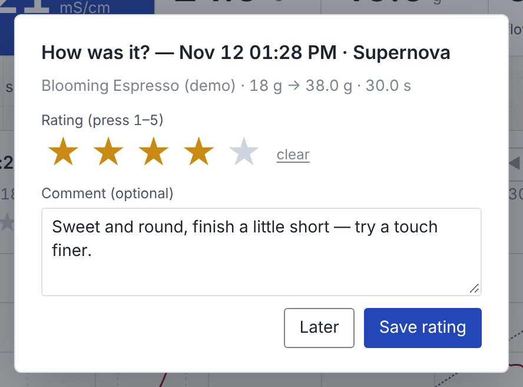 When a shot is saved the app asks *How was it?* — one to five stars (press 1–5 or click) and a comment — after the final-weight prompt when that is on, and *Later* skips it (the prompt can be turned off under *Settings → Recording → Rating*). The stars sit under the shot's title on the Shots tab, where clicking one re-rates the shot in place and *Edit comment* opens the dialog again; History shows the rating in a sortable **★** column (💬 marks a comment, which the tooltip and the search show), and *Edit* changes both. Rating and comment are saved with the shot, go into the shot JSON, the summary CSV (`rating`, `comment`), the PDF report (*Your rating*, *Your comment*), the Beanconqueror hand-off (its rating field and a *Cup:* line in the note) and the AI review, where the digest carries them as your verdict on the cup and the series comparison tracks the rating from shot to shot.
9. **History** (top bar) lists every saved shot: when, coffee and roaster, profile, **grind** (µm), dose → beverage, **brew ratio** (1 : 2.2, from the dose and the beverage), time, mean EC/g, TDS (bold = refractometer reading, italic = estimate), your **★ rating** and what the shot holds — Portal and machine sample counts, whether the machine's record is attached (⌂) and whether its files have been written (▤). Search across bean, roaster, origin, grinder, grind, profile, note and comment; filter to shots with Portal data, with or without a reading, machine-only, or files not yet written; sort by any column. Click a row to select it, *Open* (or double-click) to show it on the Shots tab, *Edit* to change its coffee, dose, grind, grinder, note, rating, comment, refractometer reading and **beverage weighed** in a dialog, *Delete* (or tick several and *Delete selected*) to remove it after a confirmation.

   **The final weight of a brew.** 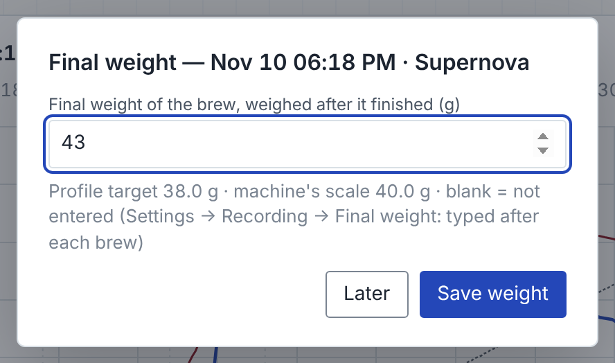 The beverage used for yield, ratio and EY comes from one of three places, chosen under *Settings → Recording → Final weight*: the **profile's `final_weight`** (the default — the machine stops the pump at that target, so the cup ends up at the target plus drips), the **machine's scale once the brew has completed** (the reading at the end of the recording, drips in the settle window included), or **a value you type after each brew** (the app asks when the shot is saved; until you answer the shot shows *? g* — on the Shots tab as an *Enter final weight* button, in History as a *? g* link). A weight you type always wins over the other two, whichever option is chosen, and is marked ⚖; the profile target is marked ◎ (tooltip: what the scale saw); the Shots header says which one is in use, e.g. "43.0 g out (weighed; machine 42.6 g)". The profile target is read from the **machine's own record of the shot** (the profile exactly as it was brewed — `final_weight`, or a `$variable` or weight variable when the profile keeps it there), so two profiles that share a name cannot be mixed up; until the record is attached it comes from the loaded profile's id in the status stream, and a name that is not unique is left to the record rather than guessed. Whatever the source, it is the beverage used for yield, EY, the ratio, the summary CSV (`beverage_g`, with `beverage_source`, `profile_target_g` and `machine_weight_g` beside it), the PDF, the Beanconqueror hand-off and the AI review (whose digest states in words which figure is the cup, which the profile's aim and which the scale); the EC analysis itself always runs against the scale's curve. Tick two to eight shots and press **Compare selected** to overlay their graphs on one chart — EC vs cup mass, ∫EC dm vs cup mass, or EC, cup weight, flow and pressure vs time — with a legend of dose → yield, ratio, time, peak EC, EC/g and TDS per shot; the mass axis can be switched to *brew ratio* (cup mass ÷ dose) so shots with different doses line up.

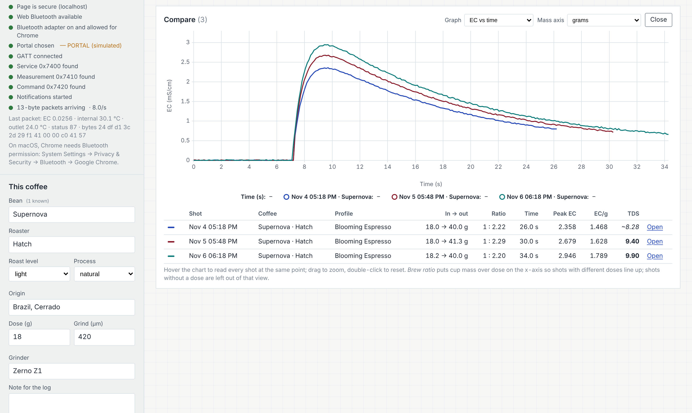 The **This coffee** panel on the Shots tab describes the *next* shot and is written into the one you just pulled while it is the most recent; anything older is edited from History, so preparing the next brew never rewrites an old shot.

10. **Brew from the app.** 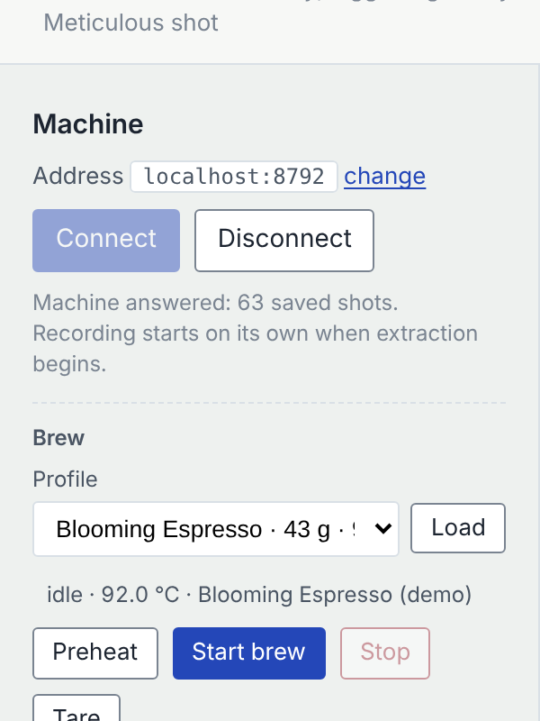 While the machine is connected, the Machine section of the Shots rail grows a **Brew** block: pick a profile and *Load* it, then **Start brew** sends the dial's own click over the machine's API (`/api/v1/action/start`). From idle the machine loads the profile and heats; the line under the picker follows its status ("Heating · 92.1 °C", then **Ready — click to start**), and at that point *Start brew now* begins the shot without touching the knob. **Start brew turns green when the water is at temperature**: the line under it follows the chosen sensor against the loaded profile's target ("heating · 71.2 °C · target 93.0 °C · within the tolerance for 4 of 10 s", then "water ready (held)"), using the rule from *Settings → Machine → Ready to brew*; after the shot the button goes back to the plain colour of *Tare* until the machine heats for the next one. *Preheat* heats without starting, *Stop* ends a running profile the safe way (the piston retracts), *Tare* zeroes the scale. If you would rather skip the second press altogether, the machine has an *auto-start after preheat* setting of its own. These buttons only ever do what the dial does; nothing is sent unless you press them.

11. **Analysis** (top bar): a stage-by-stage review of one or more shots by an AI model, written to the same outline as a careful human review — *Verdict*, *Stages* (time, water in, cup, what happened), *What stands out*, *Suggested changes* (first **stage by stage** — for every stage of the profile what happened, a verdict of *worked well*, *acceptable* or *needs work*, and what to change or keep — then "change one thing per shot, in this order", naming the profile variable and the value), *Open questions*, *Sources*. Tick shots in History and press **Analyze selected**, or tick them on the Analysis tab itself; several shots of the same coffee are compared as a series (a *Shots compared* table, what changed between them and what it did). The app first computes everything it can **locally and deterministically** — the per-stage table from the machine's own stage names, water in, cup weight, pressure peak/end/slope, mean flow, temperature drift, EC at the stage boundaries, where the solubles came from (share of ∫EC dm by stage end and by cup mass), first drop, pump stop and drips — shows it under *Stages, from the recording* with the shot's graph, and sends that digest, the brew profile (stages, exit triggers, limits, variables, description) and a one-row-per-second trace to the model. The model is asked to interpret those numbers, never to recompute or invent them, and to flag unconfirmed hypotheses as such. **Several shots** ticked together get a comparing report instead: a *Shots compared* table; *Stages* side by side with a column per shot and how each stage differed; *What stands out* as one item per step from shot to shot (what was varied, what it did, better / worse / no clear change) ending with the trend; *What helped and what did not* (keep / revert); and *Suggested changes* as single changes for the next shots, built on the series. The app computes the comparison itself — every setup and outcome number per shot, the deltas between consecutive shots with what was changed on purpose, every stage by name across the shots, the trends — and hands it to the model ahead of the digests.

    **Before the review** the app asks you to confirm two things for every ticked shot, and *Review with …* stays off until you have. 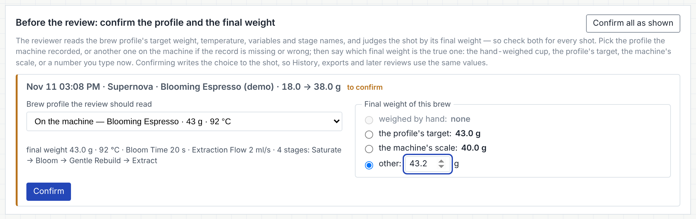 First, **which brew profile the review should read**: the one the machine recorded for that shot (the default; shown with its target weight), or **any other profile on the machine** — the picker lists them all with target and temperature, and choosing one fetches it in full (`/api/v1/profile/get/<id>`) and shows what the review will take from it: `final_weight`, the brew temperature, every variable with its value and unit (bloom time, extraction flow…), and the stage names. Use it when the record is missing (a live-only shot that says *Name only*), when the machine loaded one of two same-named profiles, or when you have since edited the profile and want the review to read the current version. Second, **the final weight of the brew**: the hand-weighed cup if there is one, the chosen profile's target, the machine's scale, or a number you type now — each choice shows its value, and the ones that do not exist for this shot are greyed out; the Settings default is preselected. *Confirm* (or *Confirm all as shown*) writes the choice to the shot — the profile with its variables, the weight (a typed number is kept as the weighed cup; *profile* or *scale* is pinned to that shot, whatever Settings says) — so History, exports, the digest below and later reviews all use the same values. The digest tells the model which profile it is reading and why ("as recorded", "chosen by the user for this review" — with the record's target kept beside it for contrast — or "name only"), and which figure is the cup. **Shots without Portal data are reviewed too**: the EC parts are marked "no Portal data" and the review works from pressure, flow, cup weight and temperature. Add how it tasted and what you want to know, press *Review with …*, and the report streams in. The output budget grows with the number of shots (8 k tokens for one, 4 k more per extra shot, up to 16 k), and **a report the model cuts off at its output limit is continued automatically**: the app sends the text so far back as the model's own turn and asks it to carry on exactly where it stopped (twice at most; the status line says "in 2 parts"), so a series review is never left hanging mid-sentence; if it still ends early a *Continue the review* button asks for the rest by hand. **Save review** keeps it in the browser (with the digest it was based on; backups include it); saved reviews are listed below with *Open*, a format picker, *Download* and *Delete*. A review downloads as **Markdown (.md), Word (.docx) or PDF (.pdf)** — the picker next to each *Download* button chooses, and *Settings → AI review → Download reviews as* sets the default (Markdown out of the box). All three carry the same header (title, date, provider and model, the shots, your taste note and question) and the same sections; the Word file is built in the page (no server), the PDF with jsPDF. *Copy* puts the Markdown on the clipboard. Setup is under *Settings → AI review*, see below.

    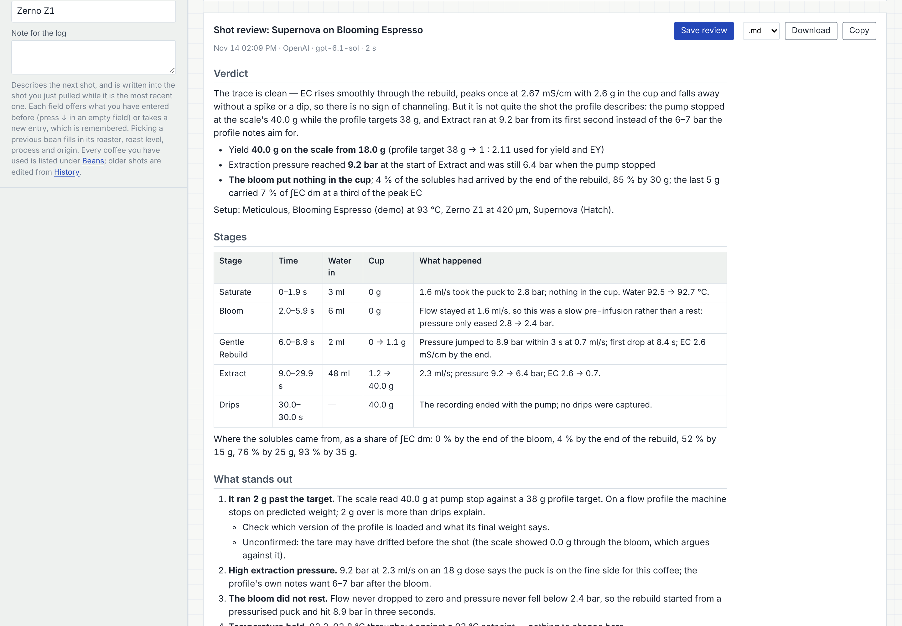

### Settings

The **Settings** tab (top bar) holds everything that is not about one shot. A **save bar** sits at the top of it: toggles and drop-downs commit the moment you change them, while typed fields (the machine address, seconds, counts) wait until you press **Enter**, **⌘S** / Ctrl+S, or the **Save settings** button — the bar lists what is still pending and *Discard changes* puts the saved values back. Switching to another tab saves anything pending, and Chrome warns before closing the page with unsaved edits. Every save is confirmed in the bar ("Saved 1 setting (machine address) at 7:42:10 PM").

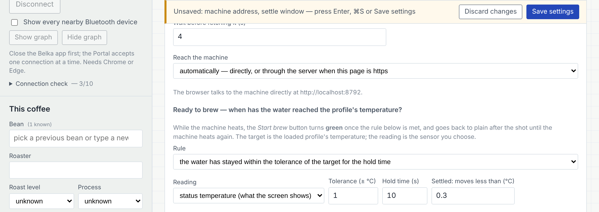

- **Machine** — address, *Test connection* (tests the address as typed, saved or not), connect on open, whether to fetch the machine's own saved record after each shot (and how long to wait for it), and **how the page reaches the machine**: directly from the browser, or through the server that serves the page (`serve.mjs` relays `/machine/<address>/…` to the machine, REST and the live socket alike). *Automatically* uses the relay when the page is https — a secure page may not call the machine's plain-http API itself — which is how the Home Assistant app's https address works. Once the address is saved, the **Address** shown on the Shots tab (with its *change* link) follows it, and the app reconnects to the new address. **Ready to brew** chooses how the app decides that the brew water has reached the profile's temperature (the green *Start brew*): *the machine says so* (it reports "click to start"), *within the tolerance of the target* (the first reading that is), *held within the tolerance for the hold time* (the default: ±1 °C for 10 s), *settled* (held, and moved by less than a threshold over that time), or *the machine says so and the hold rule agrees*; which reading to use (the status temperature the machine's screen shows, external probe 1 or 2, the tube, or the mean of the bar heaters), and the tolerance, hold time and settle threshold. The live readings and the current verdict are shown underneath while the machine is connected, so the sensor can be chosen by watching which one tracks the brew water.
- **AI review** — which provider writes the reviews (Claude / Anthropic, OpenAI, or Gemini / Google), that provider's API key and model, an optional OpenAI-compatible endpoint (OpenRouter, a local model server — anything that speaks the OpenAI chat API), *List models* (fills the model picker from the provider) and *Test key*, plus what the reviewer should know about you: the grinder's step size in µm (so grind advice comes in whole steps), how you usually drink the coffee (ratio targets differ for a cortado and a straight shot) and standing notes (burrs, water, basket). The key is stored in this browser's IndexedDB on this computer, shown masked, kept out of settings exports and backups, never written to the debug log, and sent only to the provider you chose. See [Getting an API key](#getting-an-api-key) below. **Download reviews as** sets the default file format for saved reviews (Markdown, Word or PDF).

  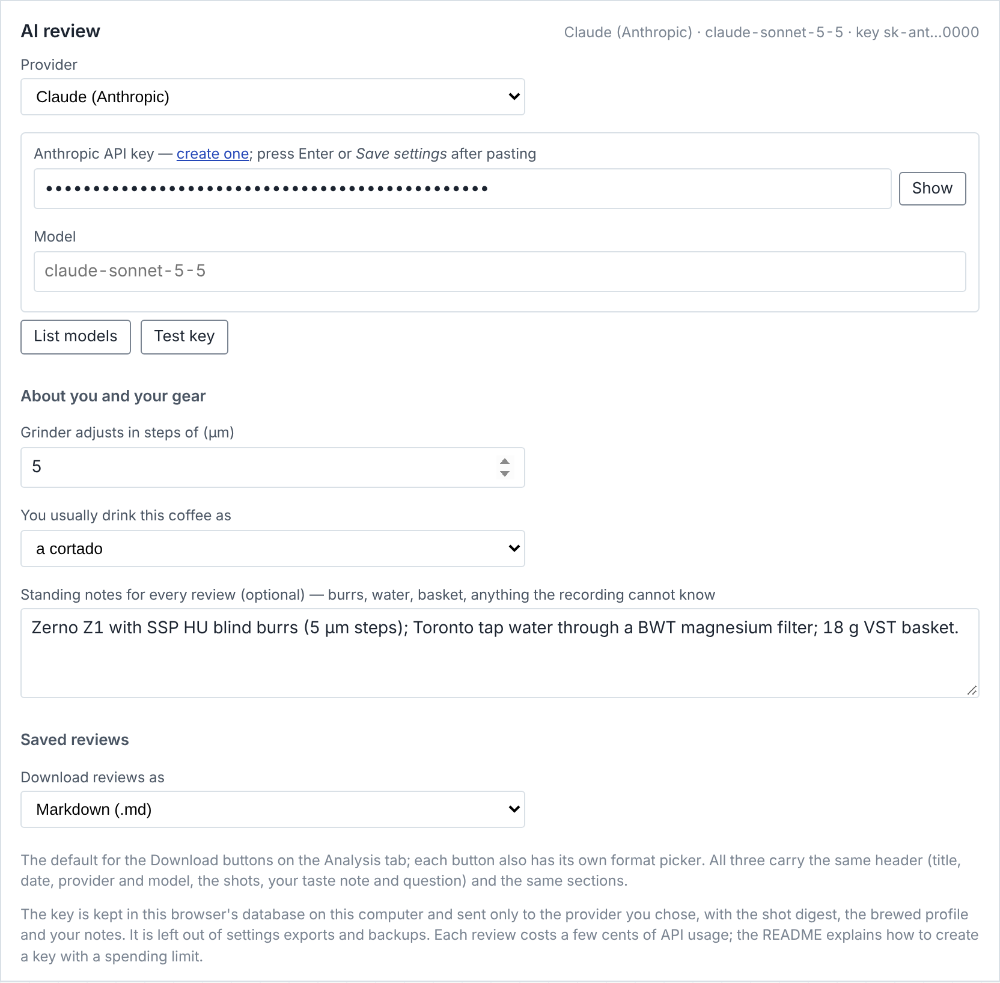
- **Recording** — automatic start on `extracting` (or manual only), the settle window after the pump stops, the Portal-vs-cup lag, the minimum length an automatic recording must have to be kept, whether to switch the Portal's screen to its graph during a shot, **Final weight** (where the beverage comes from when you have not typed it: the brewed profile's `final_weight` — the default —, the machine's scale once the brew has completed, or a value you type after each brew). The database checkpoint during recording and the machine-record backfill are always on.
- **Files and folders** — where everything the app writes as a *file* goes, and what the folders are called. 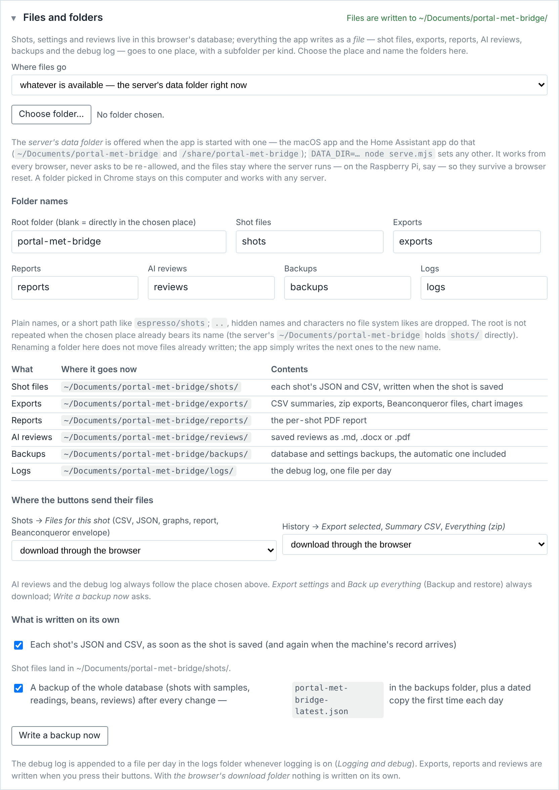 *Where files go*: **a folder on this computer** (Chrome's folder picker; Chrome asks you to re-allow it after a restart), **the data folder of the server** that serves the page (offered when the server was started with one — `start.command`, the macOS app and the Home Assistant app do that: `~/Documents/portal-met-bridge` on a Mac, `/share/portal-met-bridge` on the Pi; it works from any browser, never asks to be re-allowed, and the files stay where the server runs), or **the browser's download folder** (one file at a time, nothing written on its own). *Whatever is available* — the default — takes a chosen folder first, then the server's folder, then downloads. Under either folder the layout is one **root folder** (`portal-met-bridge/`, or blank for directly in the folder) with a subfolder per kind, each renamable (the root is not repeated when the place already bears its name, so the server's `~/Documents/portal-met-bridge` holds `shots/` directly): **shot files** (each shot's JSON and CSV), **exports** (CSV summaries, zips, Beanconqueror files, chart images), **reports** (the per-shot PDF), **AI reviews**, **backups** and **logs**; a table shows where each kind lands right now. Two things are written on their own when a destination is set: each shot's JSON and CSV as it is saved (and again when the machine's record arrives), and an **automatic backup** of the whole database — `backups/portal-met-bridge-latest.json` after every change, plus a dated copy the first time each day — which *Backup and restore → Restore* loads into any browser; *Write a backup now* does it on demand. The debug log is appended there too, as a file per day, whenever logging is on.
- **Estimates** — how many reference shots an estimate needs before it stops being *preliminary*.
- **Pick-lists** — the beans, roasters, origins and grinders the coffee fields offer, with use counts; remove an entry here (shots keep their values).
- **Backup and restore** — *Export settings* / *Import settings* (a small JSON: address, recording, estimate and logging options, current coffee), *Reset to defaults*, and *Back up everything* / *Restore* (all shots with samples and readings, the bean library, settings; restore merges by shot id).
- **Stop** (top bar, right) — one confirmation, then everything the page runs stops: a recording in progress is finished and saved first, an AI review being written is cancelled, the Portal and the machine are disconnected, the live loops and timers stop, a pending automatic backup and the log are written. The dialog offers to stop a brew running on the machine too, and — when the page is served from this computer by `start.command`, the macOS app or `node serve.mjs` — to stop that server as well (`POST api/quit`; the app or Terminal window then exits). Without that box the server keeps serving and *Start again* reloads the page. Nothing saved is touched. In the Home Assistant app the same box — ticked by default there — stops the app itself through the Supervisor, so Home Assistant shows it stopped until you press Start.
- **Logging and debug** — turn on a debug log (connections, GATT steps, recorder transitions, exports, errors; optionally every Portal packet and machine status), and choose the detail level. The last 5,000 lines live in the page (download them as text or JSON lines, or copy the tail), and whenever a file destination is set (*Files and folders*) the log is also appended there as `logs/<date>.log` while you brew. A live tail shows the last 300 lines.

- **Start over** — *Erase everything and start fresh…* deletes all of the app's data in this browser (shots and samples, readings, bean library, settings, the in-page log, the Portal pairing) and, if you tick it, the files it wrote at the file destination (only its own root folder, or only its own subfolders when the root is blank). It lists exactly what will go, asks you to type `ERASE`, then restarts with defaults. There is no undo, so take a backup first if in doubt.

The connection check, the live tail and *Download log* together are what to send with a bug report.

The **Machine** tab (top bar) shows live state, stage, shot timer, setpoints, boiler/brew-head/bar/tube/motor temperatures with a five-minute chart, heater and motor power, the profiles on the machine with their images and variables, shot statistics by profile, device info (firmware, image channel, serial, component versions), Wi-Fi status and health, notifications, and read-only settings.

No hardware handy? *Add a demo shot* and *Replay a demo live* exercise everything with a synthetic shot.

### Getting an API key

The Analysis tab talks to the provider directly from the page (the page runs on `http://localhost`, and all three APIs allow browser calls). You pay the provider for what you use; a review of one shot sends roughly 6–10 k tokens and gets back 1–2 k, which is a few cents on a mid-range model. Create the key on an account with a spending limit, paste it under *Settings → AI review*, press Enter or *Save settings*, then *Test key*.

**Claude (Anthropic)** — the default.
1. Sign in at [console.anthropic.com](https://console.anthropic.com) (create an account if needed) and add a payment method or credits under *Settings → Billing*; set a monthly spend limit there.
2. *Settings → API keys* → **Create Key**, give it a name such as `portal-met-bridge`, copy it (it starts with `sk-ant-` and is shown once).
3. In the app choose *Claude (Anthropic)*, paste the key, leave the model blank for the default (`claude-sonnet-5-5`) or press *List models* and pick another (a Haiku model is cheaper and quicker; an Opus model is the most thorough).

**OpenAI**
1. Sign in at [platform.openai.com](https://platform.openai.com), add billing under *Settings → Billing* and set a monthly budget under *Limits*.
2. [*API keys*](https://platform.openai.com/api-keys) → **Create new secret key** (owned by you, all permissions or at least `model.request`), name it, copy it (`sk-…`, shown once).
3. In the app choose *OpenAI*, paste the key, leave the model blank for the default (`gpt-6.1-sol`) or *List models* to pick. The *OpenAI-compatible endpoint* field is for other servers that speak the same API — e.g. OpenRouter (`https://openrouter.ai/api`, with its own key) or a local model (`http://localhost:11434` for Ollama, `http://localhost:1234` for LM Studio); leave it blank for OpenAI itself.

**Gemini (Google)**
1. Sign in at [Google AI Studio](https://aistudio.google.com) with a Google account.
2. **Get API key** → *Create API key* (in a new or existing Google Cloud project); copy it (`AIza…`). The free tier has daily limits; billing can be enabled on the project for more.
3. In the app choose *Gemini (Google)*, paste the key, leave the model blank for the default (`gemini-3.8-flash`) or *List models* to pick (the Pro / flagship models give longer, more careful reviews).

**Keep the key safe.** It lives in this browser's database on this computer only. If the browser profile is shared, use a key you can revoke, and revoke it from the provider's console if in doubt. *Start over* under Settings deletes it with everything else.

**If a request fails:** a `401`/`403` means the key is wrong or has no access — re-paste it; a `404` means the model name is wrong — press *List models*; a `429` is a rate or spending limit on the account; "could not reach …" with a CORS message in the console means the endpoint does not allow browser calls (OpenAI, Anthropic and Google do; some proxies do not). A `400` that names a parameter (for example Anthropic's "`temperature` is deprecated for this model" on Opus 5.5, or OpenAI's "Unsupported parameter") is handled for you: since v0.11.2 the app sends no sampling parameters at all, and if a model still refuses one the request is retried once without it (the debug log notes the retry).

### Portal on macOS with Chrome — checklist

- Chrome 56+ or Edge; Safari and Firefox have no Web Bluetooth.
- The page must come from `http://localhost` (what `start.command` does). `file://` and `http://192.168.x.x` are not secure origins and the Connect button will say so.
- macOS asks once whether Google Chrome may use Bluetooth; if you declined, turn it on under **System Settings → Privacy & Security → Bluetooth**. The *adapter* step in the Connection check turns red until it is allowed.
- The Portal is awake and **not connected to the Belka phone app** (one central at a time).
- Chrome's chooser filters on the Portal's advertised service (`0x7400`) with name fallbacks (`PORTAL`, `Belka`). If the list is empty, tick *Show every nearby Bluetooth device*; if it then appears under another name, please say so in issue #1.
- `chrome://bluetooth-internals` shows what Chrome can see if the chooser stays empty.

### Tests

```bash
npm test                 # unit tests: analysis maths, calibration pools, packet parser, CSV, hand-off round-trip, review digest + prompt, markdown, AI providers
npm i -D playwright socket.io
npm run test:e2e         # real Chrome + simulated Portal + mock machine: connect, record, analyse, export
npm run screenshots      # regenerates docs/screenshot-*.png from the running app (same fixtures)
npm run mock             # a stand-in machine on :8080 for manual poking
```

The end-to-end test injects `tests/fake-bluetooth.js`, a stand-in `navigator.bluetooth` that behaves like a Portal (service `0x7400`, 13-byte notifications at 8 Hz, command acks), and `tests/fake-folder.js`, an in-memory folder picker, and checks 173 things from the chooser filter through recording (including the two-second checkpoint, the profile target picked up at the start and from the attached record, and the automatic JSON/CSV files), History (search, filter, the grind column, the ★ column, edit including the weighed beverage and the rating, the beverage-weight setting, compare overlays, open, delete with confirmation), the rating dialog after a shot (keys 1–5, the comment, re-rating from the stars under the title, the auto-written JSON following), the AI review (settings, model list and key test against the mock's OpenAI-compatible endpoint, the pre-review confirmation — a machine profile chosen over the record and fetched in full, a typed final weight, the pin of the scale on another shot, un-confirming on a change — a three-shot review with one shot lacking Portal data, the rating in the digest, save/open/download as .md/.docx/.pdf/delete, a wrong-model error, a model that stops at its output limit and is continued without repeating itself, the PDF report growing by the saved review's pages, the Machine tab under a machine that answers with markup in every field (nothing runs, everything shows as text), keys kept out of exports and the log), the final weight (two same-named profiles told apart by id, the typed-after-brew mode with its dialog), the brew controls (start → "click to start", stop, profile load against the mock's dial), pick-lists, the settings save bar, logging, settings export, the zip export, the ready-to-brew rules against the mock's temperature ramp (plain while heating, green once held, plain again after a brew, the machine's own word as a rule, the live readings in Settings), the Stop button (the confirmation, cancel, the stop itself, and `api/quit` against a second server), the machine reached through the server's `/machine/` relay (Test connection, the live socket, a refused public host), the file destinations (the server's data folder advertised and chosen, a CSV export, the log and the automatic backup landing on disk under renamed folders, cleaned folder names, refused escape paths), a full erase-and-restart, the recovery of a checkpoint left by an interrupted session, and the upgrade of pre-0.10 shots whose weighed cup lived on the reading. It proves the code path; a physical Portal still has to prove the protocol.

## What is in the box

```
index.html, css/app.css      the page (Shots view + Machine view)
js/portal-ble.js             Belka Portal Web Bluetooth driver
js/meticulous.js             socket.io status/sensors stream + /api/v1 client
js/machine-panel.js          Machine dashboard (status, temps, profiles, stats, device, connectivity)
js/recorder.js               joins both streams on one clock; auto start/stop
js/analysis.js               mass-space integration, tail features, calibration fits
js/beanconqueror.js          ADD_BREW envelope, gzip → base64url → chunked deep link, QR sizing
js/charts.js                 uPlot views (time with stage markers, EC vs mass, calibration)
js/export.js                 chart JPEGs, PDF report, summary CSV, zip bundle
js/log.js                    debug log: ring buffer, live tail, a file per day at the file destination
js/heat.js                   ready-to-brew: the temperature rules (machine / reached / held / settled / both) and the sensor choice
js/files.js                  where files go: downloads / a picked folder (File System Access API) / the server's data folder; root + subfolder per kind
js/store.js                  IndexedDB: shots, beans, pick-lists, saved reviews, settings
js/review.js                 shot digest (stages, water, cup, EC shares, the profile read and why), review prompt, Markdown renderer
js/review-export.js          saved reviews as Markdown, Word (.docx, built in the page) and PDF (jsPDF)
js/ai.js                     Claude / OpenAI / Gemini clients: requests, SSE streaming, model lists
js/demo.js                   synthetic shot
tests/run.mjs                unit tests (node)
tests/e2e-portal.mjs         end-to-end in Chrome with a simulated Portal + mock machine
tests/fake-bluetooth.js      the simulated Portal (navigator.bluetooth stand-in)
tests/fake-folder.js         in-memory stand-in for the folder picker
tests/mock-meticulous.mjs    the mock machine (socket.io + REST, dial actions) and a mock OpenAI-compatible chat endpoint
serve.mjs, start.command     local server: static files, the optional data-folder API, an optional https listener, the /machine/ relay, api/server + api/quit / macOS launcher
tools/package-macos.sh       builds "Portal Met Bridge.app" (launcher + page + bundled Node); tools/tag-release.sh tags a release
.github/workflows/           release.yml (macOS app → GitHub Release), ha-app.yml (Home Assistant image → GHCR, optional)
homeassistant/, repository.yaml  the Home Assistant app (config.yaml, Dockerfile, run.sh, DOCS.md) and the repository manifest
docs/PACKAGING.md            how the macOS app and the Home Assistant app are built, published and installed
docs/RELEASING.md            the release walkthrough: bump, tag, the workflow, publishing the draft, attaching the macOS package by hand
vendor/                      uPlot 1.6.32, socket.io-client 4.8.4, qrcode-generator 2.0.4, jsPDF 2.5.2, fflate 0.8.3 (all MIT)
docs/NOTES.md                protocol findings, with sources
```

## How this was built

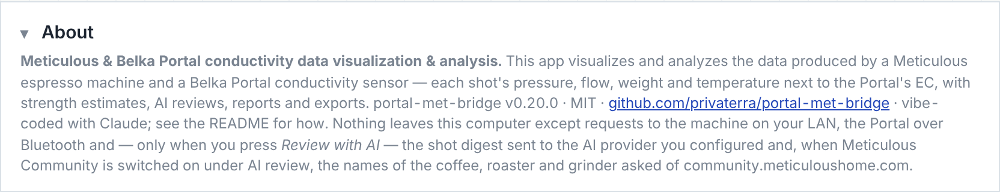

This project was **vibe-coded**: the author described what he wanted in conversation and an AI assistant wrote the code, ran it against a mock and against the real machine's REST API, and iterated on screenshots. Nothing here was typed by hand. That is worth knowing when you read the code — it is coherent, but it has had one pair of eyes on it and no field use yet.

**AI used**

- Claude (Anthropic) — model `claude-fable-5-1`, in the Claude app's agentic mode with a Linux sandbox, a headless Chrome for UI checks, and a Chrome extension to read the real machine's API on the author's LAN. Sessions on 2026-11-08 to 2026-11-11.

**What the AI read before writing**

- [variegated-coffee/variegated-rs](https://github.com/variegated-coffee/variegated-rs/tree/main/crates/variegated-belka-portal-trouble-driver) — the Rust Belka Portal BLE driver (MIT, Magnus Nordlander). Source of the service/characteristic UUIDs, the 13-byte notification layout and the two display commands.
- [janhcla/Decenza](https://github.com/janhcla/Decenza) (fork of [Kulitorum/Decenza](https://github.com/Kulitorum/Decenza), GPL-3.0) — the Portal integration for Decent machines, especially `src/ai/portaltailanalyzer.h/.cpp` and `openspec/specs/belka-portal/spec.md`. The mass-weighted analysis and calibration *approach* were learned from it; the code here is an independent JavaScript implementation, not a port, so no GPL code is included.
- [MeticulousHome/meticulous-backend](https://github.com/MeticulousHome/meticulous-backend) — the machine's Tornado/socket.io backend: event payloads, REST routes, shot file format.
- [nickwilsonr/meticulous-addon](https://github.com/nickwilsonr/meticulous-addon) — the Home Assistant add-on (MIT). Source of the port-80 finding and the sensor catalogue the Machine view mirrors.
- [hessius/MeticAI](https://github.com/hessius/MeticAI) — how another tool talks to the machine's history API.
- [graphefruit/Beanconqueror](https://github.com/graphefruit/Beanconqueror) `docs/brew-import-api.md` — the `beanconqueror://ADD_BREW` hand-off contract, decoder limits and envelope schema.
- Belka's product page and Kickstarter FAQ, and the Daily Coffee News write-up, for what the device measures.

**Libraries (vendored, all MIT)**

- [uPlot](https://github.com/leeoniya/uPlot) 1.6.32 — charts
- [socket.io-client](https://github.com/socketio/socket.io-client) 4.8.4 — the machine's live stream
- [qrcode-generator](https://github.com/kazuhikoarase/qrcode-generator) 2.0.4 — QR for the Beanconqueror link
- [jsPDF](https://github.com/parallax/jsPDF) 2.5.2 — the PDF report (loaded only when you ask for one)
- [fflate](https://github.com/101arrowz/fflate) 0.8.3 — the zip export

Dev-only: [Playwright](https://playwright.dev) and [socket.io](https://socket.io) for the end-to-end test and the mock machine.

No build step, no framework, no bundler: plain ES modules served statically.

**Platform APIs**: Web Bluetooth (Portal), `fetch` + socket.io over CORS (machine), `CompressionStream` (gzip for the hand-off), IndexedDB (storage), File System Access API (optional log/export folder; Chrome and Edge only).

## Protocol notes

See [docs/NOTES.md](docs/NOTES.md) for the Portal BLE layout, the Meticulous endpoints as observed on firmware 0.2.24 (beta), and the Beanconqueror envelope. Short version:

| | |
| --- | --- |
| Portal service / measurement / command | `0x7400` / `0x7410` (notify, 13 bytes: EC f32, internal °C f32, outlet °C f32, status u8) / `0x7420` (write `40 00 01 2D` show graph, `40 00 01 2E` hide) |
| Meticulous | `http://<ip>/` port 80; socket.io `status` (~10 Hz) and `sensors`; `GET /api/v1/machine`, `/history/stats`, `/history/last`, `/profile/list`, `/settings`, `/wifi/config`; `POST /api/v1/history` |
| Beanconqueror | `beanconqueror://ADD_BREW?len=N&shareBrew0=…` — `base64url(gzip(JSON))`, 400-char chunks; **no TDS field**, so the estimate goes in the note and `imported.params` |

## Known limits

- Web Bluetooth has no background mode: keep the tab open while pulling shots.
- The QR code carries a thinned trace (≈30 points) so phones can read it; the copied link is full resolution.
- Beanconqueror only accepts the deep link on its own device (phone/iPad).
- The Portal driver is written from the protocol source and a second project's on-device verification, and tested against a simulated Portal, not against the author's own Portal. The first live connection may need the lag and settle settings tuned; the Connection check will show where it gets to.
- Estimates borrowed from a wider pool (same roaster, same roast level, all coffees) are rougher than the bean's own; the flag says which pool was used. Different coffees really do have different EC-to-TDS ratios.
- The machine's saved shot carries the external-probe temperatures but no "brew temperature" field; the live stream's `sensors.t` is kept when the saved record is attached.
- Everything about EC → TDS is empirical. Keep the same Portal, water and mounting while you collect references, and expect k to shift between coffees.
- The Word and PDF exports of a review are written in the page: Word gets real headings, lists and tables (no numbering definitions, so list markers are text), the PDF uses jsPDF's built-in Helvetica, which cannot draw → ∫ µ and a few other symbols — they are spelled out (`->`, `integral`, `u`) in the PDF only.
- The AI review is a reading of the numbers by a language model: it can misjudge, and it only knows what the digest, the profile and your notes tell it (it cannot taste the cup or see the puck). Treat *Suggested changes* as a plan to test one step at a time, and check any figure it quotes against the *Stages, from the recording* table above it. The review needs the machine's record attached for exact stage names; a live-only shot is reviewed with approximate stages (choosing the profile from the machine before the review gives it the profile's stage names, targets and variables, but not the timings the record would carry), and a shot without Portal data without any concentration information.
- The server's data folder is written through a small HTTP API on the same origin as the page, with paths confined to that folder. Anyone who can reach the page can write there, which on `localhost` is only you; on a LAN (the Home Assistant app binds every interface inside its container) it is everyone on that LAN — keep the port off the internet.
- *Start brew* can only do what the dial's click does; whether the machine waits at "click to start" after heating is the machine's own setting. The green *ready* colour is a reading of a temperature sensor against the profile's setpoint with the rule you chose; which sensor best stands for the water that reaches the puck is for you to judge from the live readings in Settings — the status temperature is what the machine itself shows.

## Contributing

[CONTRIBUTING.md](CONTRIBUTING.md) lists what would help most (a real Portal, refractometer comparisons, other firmware). If you want your commits to carry GitHub's green **Verified** badge, [docs/SIGNED-COMMITS.md](docs/SIGNED-COMMITS.md) is a step-by-step for macOS, including the per-delivery routine for signing commits an AI session produced before pushing them; `tools/publish.sh` runs that routine (fetch, rebase, sign, push) with checks.

## License

MIT — see [LICENSE](LICENSE). Vendored libraries keep their own MIT licenses in `vendor/`.
