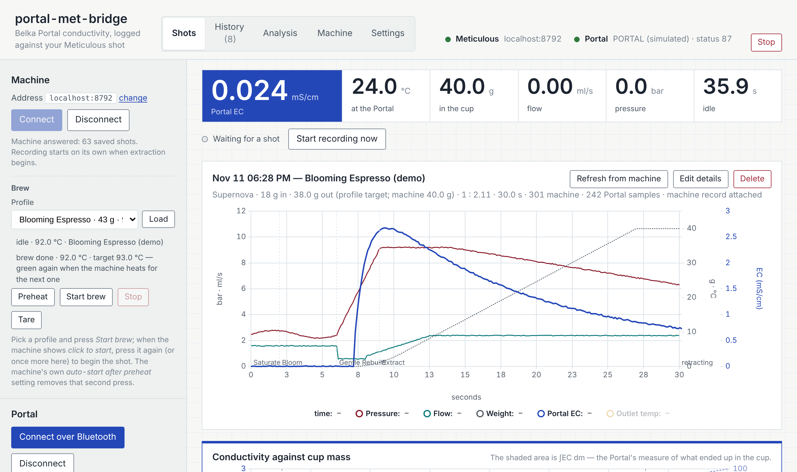

**portal-met-bridge 0.16.0 — first alpha.** A local web app that records a [Belka Portal](https://www.belka.coffee/)'s conductivity stream alongside a [Meticulous](https://meticuloushome.com/) espresso shot, integrates it against the cup weight, estimates TDS from your own refractometer readings, reviews shots with an AI model of your choice, hands the brew to Beanconqueror, and shows a machine dashboard. Runs on your Mac (or a Raspberry Pi) and talks to the Portal and the machine from Chrome; nothing leaves your network except the AI review you ask for.

*Alpha* means: everything below works against a simulated Portal, a mock machine and the real machine's API, and has been used by one person for a few days. The Portal driver follows the published protocol and another project's on-device verification but has not yet been proven on the author's own Portal. Please read *Known limits* and tell us what you find.



## What it does

- **Records both streams on one clock.** The Portal's 13-byte EC packets over Web Bluetooth (8 Hz) and the machine's status stream (10 Hz) are joined into one shot: recording starts when the machine reports `extracting`, runs on through the drips, checkpoints to the browser's database every two seconds, and about four seconds after the shot the machine's own saved record — with its stage names — is attached in place of the live samples.
- **Analyses the extraction in mass space.** ∫EC dm (conductivity integrated over cumulative cup mass), mean EC per gram, the peak and where it fell, the last-5-g slope, cup mass at 90 % of the integral, and the Portal's coverage of the pour. Two charts: everything against time with the machine's stages marked, and EC against cup mass with its running share.
- **Estimates TDS and EY from your refractometer**, per coffee: once you have saved readings for a bean, every shot of that bean gets an estimate with its uncertainty spelled out (*preliminary*, *extrapolated*, *unreliable*). Estimates can borrow from the same roaster, roast level or all your coffees when a bean has no readings yet, and say when they do.
- **Reviews shots with an AI model** (Claude, OpenAI or Gemini, with your own API key, chosen in Settings): a stage-by-stage report in a fixed outline — Verdict, Stages, What stands out, Suggested changes ("change one thing per shot"), Open questions, Sources — from a digest the app computes, never from the model's arithmetic. Before a review you confirm which brew profile to read (the machine's record or any profile on the machine, with its `final_weight`, temperature and variables) and which final weight is the true one. Several shots reviewed together are compared in every section — stages side by side, what changed from shot to shot and whether it helped, and the next single changes built on the series. Reviews are saved and export as Markdown, Word or PDF. Works without Portal data too.
- **Brews from the app.** Load a profile, *Start brew* (the dial's click over the API), *Stop*, *Preheat*, *Tare* — and **Start brew turns green when the brew water has reached the profile's temperature**, by a rule you choose: the machine's own "click to start", within a tolerance, held for a number of seconds, settled, or machine and held; on the sensor you choose.
- **Keeps your history.** Every shot with its coffee, dose, grind (µm), beverage and ratio, time, EC metrics and TDS; search, filter, sort, compare overlays, edit, delete. The final weight comes from the hand-weighed cup, the profile's target or the machine's scale, as you prefer, and the app asks after the brew when you want to type it.
- **Writes files where you say.** Per shot: CSV, JSON, both charts as JPEG, a one-page PDF report. For everything: a summary CSV, a zip, full database backups (automatic after every change), the debug log. Destination: a folder you pick in Chrome, the data folder of the server (the macOS app and the Home Assistant app give it one), or downloads — with a subfolder per kind.
- **Hands the brew to Beanconqueror** as a `beanconqueror://ADD_BREW` link or QR code.
- **Shows the machine**: status, temperatures and power, profiles, statistics, device, connectivity — the Home Assistant add-on's sensor catalogue in a page.
- **Stops cleanly.** A Stop button finishes and saves a recording, disconnects everything, writes pending files, and can stop the local server too.

## Install

**macOS — the app (no terminal).** Download `portal-met-bridge-0.16.0-macos.zip` (or the `.dmg`), move *Portal Met Bridge.app* to Applications and open it. It starts its own small server on `http://localhost:8787`, keeps your files in `~/Documents/portal-met-bridge`, and opens Chrome. This alpha is **not signed or notarized**, so macOS stops it the first time: right-click (control-click) the app → **Open** → **Open**, or System Settings → Privacy & Security → **Open Anyway**. Once is enough. Node is bundled; Chrome or Edge is required for the Portal's Bluetooth link.

**Home Assistant on a Raspberry Pi 5 (or any Home Assistant machine).** Settings → Apps → *Install app* → ⋮ → *Repositories* → add `https://github.com/privaterra/portal-met-bridge` → install **Portal Met Bridge** → Start. The page is at `http://homeassistant.local:8787` and the files go to `/share/portal-met-bridge`. The Portal is reached from the browser that opens the page, not from the Pi; for its Bluetooth, Chrome needs a secure page — open the app's https address (`https://homeassistant.local:8788`) after trusting its certificate once (the http page links to the certificate and the steps), or set the Chrome flag; on the https page the machine is reached through the app. The page's Stop button can stop the app in Home Assistant. Details: [docs/PACKAGING.md](https://github.com/privaterra/portal-met-bridge/blob/v0.16.0/docs/PACKAGING.md).

**From source.**

```sh
git clone https://github.com/privaterra/portal-met-bridge.git
cd portal-met-bridge
./start.command        # macOS: serves http://localhost:8787 and opens Chrome; or: node serve.mjs
```

**You need**: Chrome or Edge (Web Bluetooth); a Meticulous on your network (its API is on port 80 — enter the machine's IP or `meticulous.local` under Settings → Machine); the Belka app on your phone closed (the Portal takes one connection at a time); a refractometer only if you want TDS/EY estimates; an API key from Anthropic, OpenAI or Google only if you want AI reviews (the README says how to get one).

## In this release

| File | What it is |
| --- | --- |
| `portal-met-bridge-0.16.0-macos.zip` | *Portal Met Bridge.app* — launcher, the page, Node for Apple silicon and Intel |
| `portal-met-bridge-0.16.0-macos.dmg` | the same app on a disk image with an Applications shortcut |
| `portal-met-bridge-0.16.0-source.zip` | the repository at this tag |

Versions 0.1 to 0.16 were built in four days of sessions; the README's *Prompt history* lists what each one added.

## Known limits (please read)

- **The Portal driver is untested on a physical Portal by the author.** It is written from the [variegated-rs](https://github.com/variegated-coffee/variegated-rs) driver and the [Decenza](https://github.com/janhcla/Decenza) spec and verified against a simulated Portal only. The first live connection may need the *Portal lag* and *settle window* settings tuned; the **Connection check** under the Connect button shows each step (secure page, adapter, device, GATT, service, characteristics, notifications, packet rate) so a failure says where.
- **EC is not TDS.** The Portal measures conductivity; TDS/EY are estimates from your own refractometer readings and shift between coffees, waters and mountings. Treat *mean EC per gram* as the primary number.
- **The AI review reads numbers.** It cannot taste the cup or see the puck; check any figure it quotes against the *Stages, from the recording* table, and test its suggestions one at a time.
- **The green *Start brew*** is a temperature sensor read against the profile's setpoint with the rule you chose; which sensor best stands for the water that reaches the puck is for you to judge from the live readings in Settings.
- **Unsigned macOS app; Home Assistant builds on the device** (a minute or two on a Pi 5). Bluetooth on a LAN address needs a secure page: the app's https address with its certificate trusted once, or the Chrome flag — the page explains both.
- Tested against Meticulous firmware 0.2.24 (beta channel, image 2026M1510-beta); other versions may name stages or fields differently.
- Web Bluetooth has no background mode: keep the tab open while pulling shots. The Beanconqueror link only opens on the phone or iPad that has the app.
- The code was **written by an AI assistant from the author's descriptions** (see *How this was built* in the README) and has had one pair of eyes on it.

## What would help most

Open an [issue](https://github.com/privaterra/portal-met-bridge/issues) with:

- a session with a real Portal — Settings → Logging and debug → turn the log on (with packets) before connecting, then attach the `.log` or the downloaded text, and the Connection check's steps;
- refractometer readings next to the app's ∫EC dm for a few shots of one coffee (the summary CSV under History has both), so the calibration can be checked;
- which temperature reading tracked the brew water on your machine, and your firmware version;
- anything the machine's API answered differently (Settings → Machine → *Test connection*, or the Machine tab's Device panel).

## Credits

Built on what these projects published: [variegated-coffee/variegated-rs](https://github.com/variegated-coffee/variegated-rs) (Portal BLE protocol, MIT), [janhcla/Decenza](https://github.com/janhcla/Decenza) (the mass-weighted analysis approach; independent implementation, no GPL code included), [MeticulousHome/meticulous-backend](https://github.com/MeticulousHome/meticulous-backend) (the machine's API), [nickwilsonr/meticulous-addon](https://github.com/nickwilsonr/meticulous-addon) (the port-80 finding and the sensor catalogue, MIT), [hessius/MeticAI](https://github.com/hessius/MeticAI) and [graphefruit/Beanconqueror](https://github.com/graphefruit/Beanconqueror) (the brew-import contract). Vendored libraries, all MIT: uPlot, socket.io-client, qrcode-generator, jsPDF, fflate. Written with Claude (Anthropic) in the Claude app's agentic mode. **License: MIT.**
