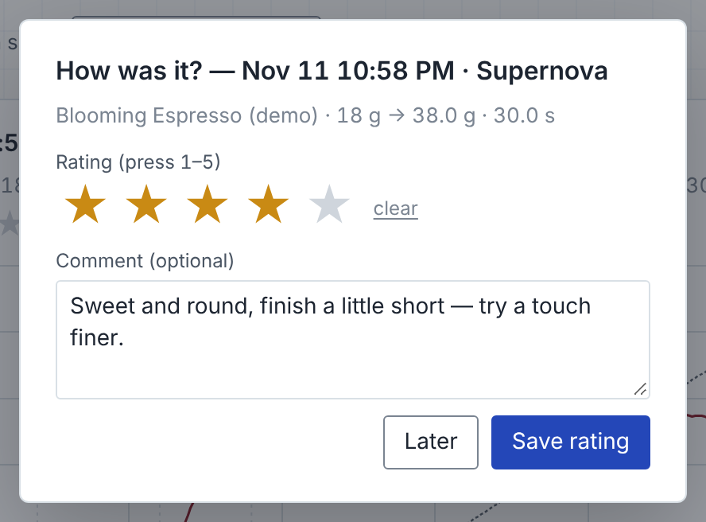

**portal-met-bridge 0.17.0 — alpha.** Meticulous & Belka Portal conductivity data visualization & analysis: a local web app that records a [Belka Portal](https://www.belka.coffee/)'s conductivity stream alongside a [Meticulous](https://meticuloushome.com/) espresso shot, integrates it against the cup weight, estimates TDS from your own refractometer readings, reviews shots with an AI model of your choice, hands the brew to Beanconqueror, and shows a machine dashboard. Runs on your Mac (or a Raspberry Pi) and talks to the Portal and the machine from Chrome; nothing leaves your network except the AI review you ask for.

Second alpha. Everything in [0.16.0](https://github.com/privaterra/portal-met-bridge/releases/tag/v0.16.0) still holds — the Portal driver follows the published protocol but has not yet been proven on the author's own Portal — plus the changes below.



## What changed since 0.16.0

- **Rate every shot.** When a shot is saved the app asks *How was it?* — one to five stars (press 1–5) and a comment; *Later* skips, and the prompt can be turned off under *Settings → Recording → Rating*. The stars sit under the shot's title (click one to re-rate), History has a sortable **★** column (💬 marks a comment), the edit dialog changes both, and the rating and comment travel with the shot: shot JSON, summary CSV (`rating`, `comment`), the PDF report, the Beanconqueror hand-off, and the AI review — where the digest carries them as your verdict on the cup and a series review tracks the rating from shot to shot.
- **The PDF report carries the AI review.** *Report (PDF)* and the zip export append the newest saved review that covers the shot — alone or as part of a series — on the pages after the charts and tables, laid out like the review PDF; the report's *AI review* row says which one it is, or *none saved*.
- **Long reviews arrive whole.** The output budget now grows with the number of shots (8 k tokens for one, +4 k per extra shot, up to 16 k) and is sent to every provider. When a model still stops at its limit the app asks it to continue exactly where it stopped — no repeat, no preamble — up to twice on its own (the status says "in 2 parts"), with a *Continue the review* button for the rest if needed. Before, a review of several shots could end mid-sentence and be saved that way.
- **A verdict for every stage.** *Suggested changes* now opens with *Stage by stage*: for each stage of the profile, in the order the machine ran them, what happened (with the stage's own numbers), whether it *worked well*, was *acceptable* or *needs work*, and what to change or keep — then the ordered single changes as before.
- **New tagline**: *Meticulous & Belka Portal conductivity data visualization & analysis* — in the page header, About, the macOS app, the Home Assistant app and the docs.
- Fixes: a missing value in the series comparison no longer shows as 0 (a shot without a grind read as "420 → 0 µm").

## Install

**macOS — the app (no terminal).** Download `portal-met-bridge-0.17.0-macos.zip` (or the `.dmg`), move *Portal Met Bridge.app* to Applications and open it. It starts its own small server on `http://localhost:8787`, keeps your files in `~/Documents/portal-met-bridge`, and opens Chrome. This alpha is **not signed or notarized**, so macOS stops it the first time: right-click (control-click) the app → **Open** → **Open**, or System Settings → Privacy & Security → **Open Anyway**. Once is enough. Node is bundled; Chrome or Edge is required for the Portal's Bluetooth link. Upgrading from 0.16: replace the app; your shots live in Chrome's database and your files in `~/Documents/portal-met-bridge`, both untouched.

**Home Assistant on a Raspberry Pi 5 (or any Home Assistant machine).** Settings → Apps → *Install app* → ⋮ → *Repositories* → add `https://github.com/privaterra/portal-met-bridge` → install **Portal Met Bridge** → Start (or press **Update** on an installed 0.16). The page is at `http://homeassistant.local:8787`, Bluetooth needs the https address `https://homeassistant.local:8788` with its certificate trusted once (the http page links to the certificate and the steps), and the files go to `/share/portal-met-bridge`. Details: [docs/PACKAGING.md](https://github.com/privaterra/portal-met-bridge/blob/v0.17.0/docs/PACKAGING.md).

**From source.**

```sh
git clone https://github.com/privaterra/portal-met-bridge.git
cd portal-met-bridge
./start.command        # macOS: serves http://localhost:8787 and opens Chrome; or: node serve.mjs
```

**You need**: Chrome or Edge (Web Bluetooth); a Meticulous on your network (its API is on port 80 — enter the machine's IP or `meticulous.local` under Settings → Machine); the Belka app on your phone closed (the Portal takes one connection at a time); a refractometer only if you want TDS/EY estimates; an API key from Anthropic, OpenAI or Google only if you want AI reviews (the README says how to get one).

## In this release

| File | What it is |
| --- | --- |
| `portal-met-bridge-0.17.0-macos.zip` | *Portal Met Bridge.app* — launcher, the page, Node for Apple silicon and Intel |
| `portal-met-bridge-0.17.0-macos.dmg` | the same app on a disk image with an Applications shortcut |
| `portal-met-bridge-0.17.0-source.zip` | the repository at this tag |

## Known limits (please read)

- **The Portal driver is untested on a physical Portal by the author.** It is written from the [variegated-rs](https://github.com/variegated-coffee/variegated-rs) driver and the [Decenza](https://github.com/janhcla/Decenza) spec and verified against a simulated Portal only. The **Connection check** under the Connect button shows each step so a failure says where.
- **EC is not TDS.** The Portal measures conductivity; TDS/EY are estimates from your own refractometer readings and shift between coffees, waters and mountings. Treat *mean EC per gram* as the primary number.
- **The AI review reads numbers.** It cannot taste the cup — that is what your rating and comment are for — or see the puck; check any figure it quotes against the *Stages, from the recording* table, and test its suggestions one at a time.
- **Unsigned macOS app; Home Assistant builds on the device** (a minute or two on a Pi 5).
- Tested against Meticulous firmware 0.2.24 (beta channel); other versions may name stages or fields differently. Web Bluetooth has no background mode: keep the tab open while pulling shots.
- The code was **written by an AI assistant from the author's descriptions** (see *How this was built* in the README) and has had one pair of eyes on it.

## What would help most

Open an [issue](https://github.com/privaterra/portal-met-bridge/issues) with a session against a real Portal (Settings → Logging and debug → log on, with packets, then the `.log` and the Connection check's steps), refractometer readings next to the app's ∫EC dm for a few shots of one coffee, or anything the machine's API answered differently.

## Credits

Built on what these projects published: [variegated-coffee/variegated-rs](https://github.com/variegated-coffee/variegated-rs) (Portal BLE protocol, MIT), [janhcla/Decenza](https://github.com/janhcla/Decenza) (the mass-weighted analysis approach; independent implementation, no GPL code included), [MeticulousHome/meticulous-backend](https://github.com/MeticulousHome/meticulous-backend) (the machine's API), [nickwilsonr/meticulous-addon](https://github.com/nickwilsonr/meticulous-addon) (the port-80 finding and the sensor catalogue, MIT), [hessius/MeticAI](https://github.com/hessius/MeticAI) and [graphefruit/Beanconqueror](https://github.com/graphefruit/Beanconqueror) (the brew-import contract). Vendored libraries, all MIT: uPlot, socket.io-client, qrcode-generator, jsPDF, fflate. Written with Claude (Anthropic) in the Claude app's agentic mode. **License: MIT.**
