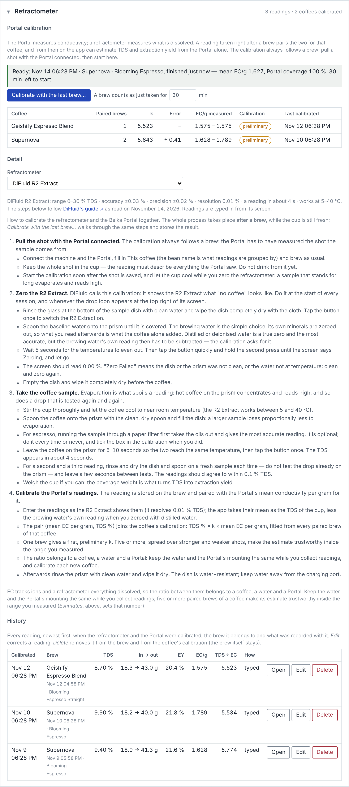

**portal-met-bridge 0.21.0 — alpha.** Meticulous & Belka Portal conductivity data visualization & analysis: a local web app that records a [Belka Portal](https://www.belka.coffee/)'s conductivity stream alongside a [Meticulous](https://meticuloushome.com/) espresso shot, integrates it against the cup weight, estimates TDS from your own refractometer readings, reviews shots with an AI model of your choice, hands the brew to Beanconqueror, and shows a machine dashboard. Runs on your Mac (or a Raspberry Pi with Home Assistant); nothing is installed on the machine or the Portal.

**The Portal driver now works on a real Portal, and the refractometer gets a section of its own.** Everything in [0.20.0](https://github.com/privaterra/portal-met-bridge/releases/tag/v0.20.0) still holds, plus the changes below.



## What changed since 0.20.0

- **The Portal driver is tested on a physical Belka Portal by the author — and it works** ([#6](https://github.com/privaterra/portal-met-bridge/issues/6)). The README, the contributing notes and the known limits no longer say otherwise. The automated tests still use a simulated Portal, so changes are checked without hardware.
- **Settings → Refractometer** (after Estimates), in three parts:
  - **Portal calibration** — *Calibrate with the last brew…* is a guided calibration that **requires a brew to have just taken place** (Portal data, finished within 30 minutes; the window is adjustable). It takes you through zeroing the refractometer, taking the coffee sample (one to three readings, averaged; a warning when they disagree) and pairing the result with the Portal's conductivity for that brew, then shows what the reading does to the coffee's calibration. A table lists every coffee's calibration.
  - **Detail** — the procedure in full; it says the process takes place after a brew. Written for the **DiFluid R2 Extract** from DiFluid's own guide (zeroing with tap-and-hold, brewing water or distilled water as the baseline, a cooled and stirred sample, a fresh sample per reading), with general steps for any other refractometer.
  - **History** — every reading with the date and what was recorded when the refractometer and the Portal were calibrated. Readings can be **edited** or **deleted**.
- After a distilled-water zero the calibration asks for the brewing water's own reading and subtracts it, as DiFluid recommends for extraction figures.
- A reading keeps what was recorded with it (the individual readings, the zeroing, the filter, the refractometer) when the brew is edited elsewhere.

## Security and libraries

Reviewed for this release: no security or vulnerability reports are open on the repository; the five shipped libraries (uPlot, socket.io-client, qrcode-generator, jsPDF, fflate) are at their current versions with no open advisories; the development tools have none either (Playwright was moved to its latest patch release). The new code adds no network access: readings are typed in, stored in the browser's database like every other shot field, escaped wherever they are shown, and restored from backups as plain numbers and text.

## You may notice

- **Readings typed on the Shots tab still work** and now appear in the Refractometer history as *typed*.
- **The guided calibration is only offered right after a brew.** For an older brew, type the reading under *Refractometer reading for this shot* or in History → Edit.
- **Readings are typed in from the R2 Extract's screen**; the app does not connect to it over Bluetooth.

## Install

**macOS — the app (no terminal).** Download `portal-met-bridge-0.21.0-macos.zip` (or the `.dmg`), move *Portal Met Bridge.app* to Applications (replace the old one) and open it. Your shots, beans, reviews and settings are kept: they live in the browser and in `~/Documents/portal-met-bridge`. It runs on Apple silicon and Intel, starts its own small server on `http://localhost:8787` and opens Chrome. It is not signed: the first time, right-click → Open.

**Home Assistant on a Raspberry Pi 5 (or any Home Assistant machine).** Settings → Apps → Portal Met Bridge → **Update** (or add the repository `https://github.com/privaterra/portal-met-bridge` and install). The image is rebuilt on the device with current Alpine packages.

**From source.**

```sh
git pull               # or: git clone https://github.com/privaterra/portal-met-bridge.git
./start.command        # macOS: serves http://localhost:8787 and opens Chrome; or: node serve.mjs
```

Reload the page once after updating (the old page is cached with the old version stamp).

## In this release

| File | What it is |
| --- | --- |
| `portal-met-bridge-0.21.0-macos.zip` | *Portal Met Bridge.app* — launcher, the page, Node for Apple silicon and Intel |
| `portal-met-bridge-0.21.0-macos.dmg` | the same app on a disk image with an Applications shortcut |
| `portal-met-bridge-0.21.0-source.zip` | the repository at this tag |

## Known limits (please read)

- **No login, by design.** On a Mac the server listens on `localhost` only; in Home Assistant it is open to your LAN, like the machine's own API. Do not forward its ports to the internet.
- **The Portal driver is tested on a physical Portal by the author** — one Portal, one Mac, Chrome. Another unit or firmware may still need the lag and settle settings tuned.
- **EC is not TDS**; TDS/EY are estimates from your own refractometer readings.
- **The AI review reads numbers**, not the cup.
- **Unsigned macOS app; Home Assistant builds on the device.**
- The security review was done **by the same AI assistant that wrote the code**, reading every file and testing each fix; it is not an independent audit. Reports are welcome — *Security → Report a vulnerability*.

## Credits

Built on what these projects published: [variegated-coffee/variegated-rs](https://github.com/variegated-coffee/variegated-rs) (Portal BLE protocol, MIT), [janhcla/Decenza](https://github.com/janhcla/Decenza) (the mass-weighted analysis approach; independent implementation), [MeticulousHome/meticulous-backend](https://github.com/MeticulousHome/meticulous-backend) (the machine API), and the libraries in `vendor/`: uPlot, socket.io-client, qrcode-generator, jsPDF and fflate (all MIT).
