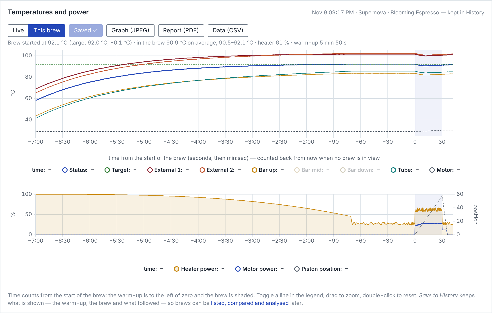
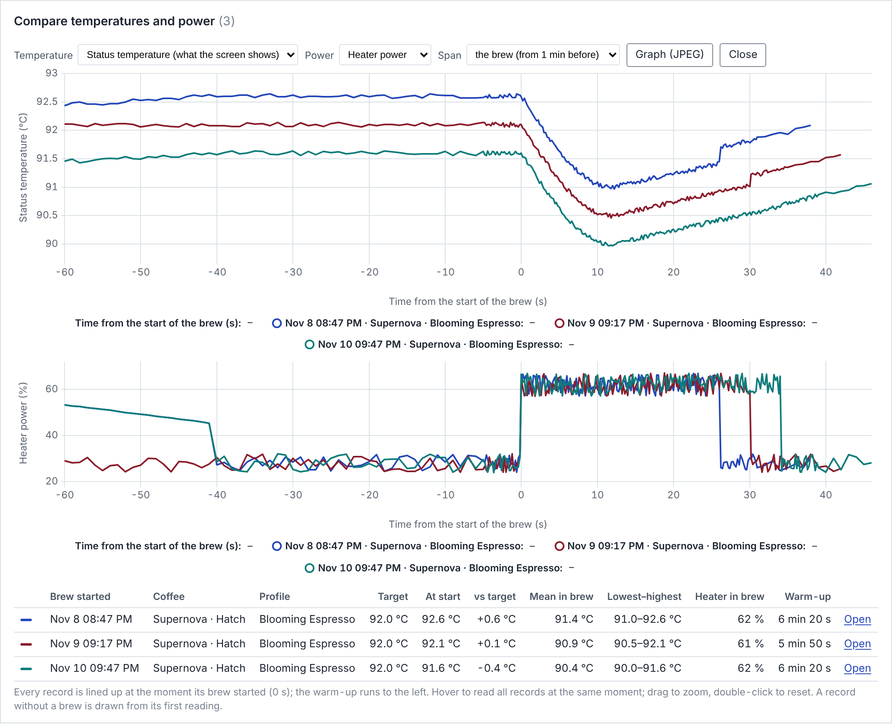

**portal-met-bridge 0.22.0 — alpha.** Meticulous & Belka Portal conductivity data visualization & analysis: a local web app that records a [Belka Portal](https://www.belka.coffee/)'s conductivity stream alongside a [Meticulous](https://meticuloushome.com/) espresso shot, integrates it against the cup weight, estimates TDS from your own refractometer readings, reviews shots with an AI model of your choice, hands the brew to Beanconqueror, and shows a machine dashboard. Runs on your Mac (or a Raspberry Pi with Home Assistant); nothing is installed on the machine or the Portal.

**Temperatures and power move to the Shots tab, follow the brew as it runs, and can be kept, compared and analysed.** Everything in [0.21.0](https://github.com/privaterra/portal-met-bridge/releases/tag/v0.21.0) still holds, plus the changes below.



## What changed since 0.21.0

- **Temperatures and power is on the Shots tab** (it was on the Machine tab), under the conductivity graph. The status temperature and the profile's target are now drawn with the probes, the bar, the tube and the motor; heater power, motor power and the piston are below.
- **During a shot the graphs follow the brew.** Time counts from the moment the brew started: the warm-up is to the left of zero and the brew is shaded.
- **After a brew its readings stay under the shot** — from the end of the previous brew (30 minutes at most) to a few seconds after the last drip — with one line of numbers: the temperature at the start and how far from the target, the mean and range during the brew, the heater's share, the warm-up. *Live* returns to the machine now (the last 5, 15 or 30 minutes); *This brew* returns to the record.
- **Save to History** keeps a brew's readings as a record. *Settings → Heating → Keep the temperatures and power of every brew* (off by default) does it for every brew. *Graph (JPEG)*, *Report (PDF)* and *Data (CSV)* are always there and download what is shown.
- **History has two folding sections**: **Brews** (the list as before) and **Temperatures and power** (the kept records). Which are open is remembered.
- **History → Temperatures and power** lists the records with search and sorting; *Open* shows one on the Shots tab, *Delete* removes it. With records ticked:
  - **Compare selected** overlays 2–8 records **lined up at the start of each brew** — a temperature and a power reading of your choice, the brew alone or with the warm-up — with a table of their numbers and a JPEG of the comparison.
  - **Analyze selected** puts the numbers side by side, marks the lowest and highest, and says what stands out. Worked out in the browser; *Ask the AI…* is optional and sends only that table and coarse readings.
  - **Export selected** writes a zip: summary CSV, and per record its readings (CSV), the record (JSON) and its graphs (JPEG).
  - **Delete selected** removes the ticked records; their brews stay.
- Kept records are part of **Back up all** and come back with a restore.



## Security and libraries

Reviewed for this release: no security or vulnerability reports are open on the repository (the one open issue asks for calibration data); the five shipped libraries (uPlot, socket.io-client, qrcode-generator, jsPDF, fflate) are at their current versions with no open advisories; the development tools have none either. The new code adds no network access of its own: records are stored in the browser's database, every name in them is escaped where it is shown, and a record restored from a backup is checked reading by reading and its numbers worked out again rather than believed. *Ask the AI…* uses the provider and key already configured for reviews and sends only the selected records' numbers.

## You may notice

- **The Machine tab no longer has the temperature tiles and graphs**; a link there opens them on the Shots tab.
- **The option "Save the heating graph and its data" is gone**: its three buttons are always shown now, and the graphs always hold 30 minutes.
- **The browser's database is upgraded once** (a store for the records is added); shots, beans, reviews and settings are untouched. A backup made by 0.22 restores into 0.21 without its temperature records.
- **A record starts when the page first saw the machine.** Connect before the machine warms up to have the warm-up in it.
- **A demo shot now comes with made-up temperatures and power**, so History → Temperatures and power can be tried without a machine. Delete them like any other record.
- **The readings are the machine's own sensors**, not a measurement in the coffee bed.

## Install

**macOS — the app (no terminal).** Download `portal-met-bridge-0.22.0-macos.zip` (or the `.dmg`), move *Portal Met Bridge.app* to Applications (replace the old one) and open it. Your shots, beans, reviews and settings are kept: they live in the browser and in `~/Documents/portal-met-bridge`. It runs on Apple silicon and Intel, starts its own small server on `http://localhost:8787` and opens Chrome. It is not signed: the first time, right-click → Open.

**Home Assistant on a Raspberry Pi 5 (or any Home Assistant machine).** Settings → Apps → Portal Met Bridge → **Update** (or add the repository `https://github.com/privaterra/portal-met-bridge` and install). The image is rebuilt on the device with current Alpine packages.

**From source.**

```sh
git pull               # or: git clone https://github.com/privaterra/portal-met-bridge.git
./start.command        # macOS: serves http://localhost:8787 and opens Chrome; or: node serve.mjs
```

Reload the page once after updating (the old page is cached with the old version stamp).

## In this release

| File | What it is |
| --- | --- |
| `portal-met-bridge-0.22.0-macos.zip` | *Portal Met Bridge.app* — launcher, the page, Node for Apple silicon and Intel |
| `portal-met-bridge-0.22.0-macos.dmg` | the same app on a disk image with an Applications shortcut |
| `portal-met-bridge-0.22.0-source.zip` | the repository at this tag |

## Known limits (please read)

- **No login, by design.** On a Mac the server listens on `localhost` only; in Home Assistant it is open to your LAN, like the machine's own API. Do not forward its ports to the internet.
- **The Portal driver is tested on a physical Portal by the author** — one Portal, one Mac, Chrome. Another unit or firmware may still need the lag and settle settings tuned.
- **EC is not TDS**; TDS/EY are estimates from your own refractometer readings.
- **The AI review reads numbers**, not the cup.
- **Unsigned macOS app; Home Assistant builds on the device.**
- The security review was done **by the same AI assistant that wrote the code**, reading every file and testing each fix; it is not an independent audit. Reports are welcome — *Security → Report a vulnerability*.

## Credits

Built on what these projects published: [variegated-coffee/variegated-rs](https://github.com/variegated-coffee/variegated-rs) (Portal BLE protocol, MIT), [janhcla/Decenza](https://github.com/janhcla/Decenza) (the mass-weighted analysis approach; independent implementation), [MeticulousHome/meticulous-backend](https://github.com/MeticulousHome/meticulous-backend) (the machine API), and the libraries in `vendor/`: uPlot, socket.io-client, qrcode-generator, jsPDF and fflate (all MIT).
