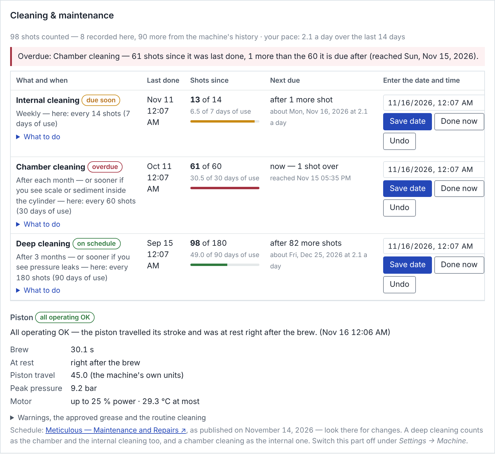

**portal-met-bridge 0.23.0 — alpha.** Meticulous & Belka Portal conductivity data visualization & analysis: a local web app that records a [Belka Portal](https://www.belka.coffee/)'s conductivity stream alongside a [Meticulous](https://meticuloushome.com/) espresso shot, integrates it against the cup weight, estimates TDS from your own refractometer readings, reviews shots with an AI model of your choice, hands the brew to Beanconqueror, and shows a machine dashboard. Runs on your Mac (or a Raspberry Pi with Home Assistant); nothing is installed on the machine or the Portal.

**The cleaning schedule now follows how much the machine is used.** Everything in [0.22.0](https://github.com/privaterra/portal-met-bridge/releases/tag/v0.22.0) still holds, plus the changes below.



## What changed since 0.22.0

- **A cleaning is due by the shots made, not only by the days passed** ([#9](https://github.com/privaterra/portal-met-bridge/issues/9)). Meticulous gives its schedule in weeks and months. The app now counts those in *days of use*: a day of use is a number of shots — **2** unless you change it — a week is seven of them, a month thirty, three months ninety. At two a day the internal cleaning is due after **14 shots**, the chamber cleaning after **60** and the deep cleaning after **180**, whether that takes three days or three weeks.
- **Every shot counts once**: the brews recorded by the app, and the shots in the machine's own history that were pulled while the app was closed. The history is read each time the machine connects.
- **The Machine tab shows the count**: *Shots since* against the number the job is due after, with the days of use that comes to; *Next due* says how many shots are left and gives an **estimated date** from your pace over the last 14 days (no date when nothing was brewed lately). The reminder under *Machine* in the left rail reads *after 5 more shots* or *2 shots over*.
- **Settings → Machine → A cleaning is due** chooses how: *by the shots made* (the default), *by the shots made or by the calendar, whichever comes first*, or *by the calendar only* (as before). **Shots in a day of use** sets the number (0.5 to 30); the line under it says what the schedule comes to.

## Security and libraries

Reviewed for this release: no security or vulnerability reports are open on the repository; the five shipped libraries (uPlot, socket.io-client, qrcode-generator, jsPDF, fflate) are at their current versions with no open advisories; the development tools have none either. The new code makes one more request to the machine you already connect to (its shot list, times only) and none anywhere else; what comes back is reduced to numbers before it is stored or shown.

## You may notice

- **Reminders change on first load.** A job that was "due in 3 days" may now read "after 9 more shots", and a job that was overdue by its date may no longer be — or the other way round if the machine is used a lot. Choose *by the calendar only* to get the old behaviour back.
- **A machine that stands unused is not reminded** when counting by shots alone. *Shots or the calendar, whichever comes first* keeps Meticulous's dates as a second limit.
- **The number of shots in a day of use is yours to set.** Meticulous does not say what use its weeks and months assume; 2 is a starting point.
- **The estimated date moves** with your pace; the number of shots left does not.
- Shots the machine no longer lists in its history are not counted.

## Install

**macOS — the app (no terminal).** Download `portal-met-bridge-0.23.0-macos.zip` (or the `.dmg`), move *Portal Met Bridge.app* to Applications (replace the old one) and open it. Your shots, beans, reviews and settings are kept: they live in the browser and in `~/Documents/portal-met-bridge`. It runs on Apple silicon and Intel, starts its own small server on `http://localhost:8787` and opens Chrome. It is not signed: the first time, right-click → Open.

**Home Assistant on a Raspberry Pi 5 (or any Home Assistant machine).** Settings → Apps → Portal Met Bridge → **Update** (or add the repository `https://github.com/privaterra/portal-met-bridge` and install). The image is rebuilt on the device with current Alpine packages.

**From source.**

```sh
git pull               # or: git clone https://github.com/privaterra/portal-met-bridge.git
./start.command        # macOS: serves http://localhost:8787 and opens Chrome; or: node serve.mjs
```

Reload the page once after updating (the old page is cached with the old version stamp).

## In this release

| File | What it is |
| --- | --- |
| `portal-met-bridge-0.23.0-macos.zip` | *Portal Met Bridge.app* — launcher, the page, Node for Apple silicon and Intel |
| `portal-met-bridge-0.23.0-macos.dmg` | the same app on a disk image with an Applications shortcut |
| `portal-met-bridge-0.23.0-source.zip` | the repository at this tag |

## Known limits (please read)

- **No login, by design.** On a Mac the server listens on `localhost` only; in Home Assistant it is open to your LAN, like the machine's own API. Do not forward its ports to the internet.
- **The Portal driver is tested on a physical Portal by the author** — one Portal, one Mac, Chrome. Another unit or firmware may still need the lag and settle settings tuned.
- **EC is not TDS**; TDS/EY are estimates from your own refractometer readings.
- **The AI review reads numbers**, not the cup.
- **Unsigned macOS app; Home Assistant builds on the device.**
- The security review was done **by the same AI assistant that wrote the code**, reading every file and testing each fix; it is not an independent audit. Reports are welcome — *Security → Report a vulnerability*.

## Credits

Built on what these projects published: [variegated-coffee/variegated-rs](https://github.com/variegated-coffee/variegated-rs) (Portal BLE protocol, MIT), [janhcla/Decenza](https://github.com/janhcla/Decenza) (the mass-weighted analysis approach; independent implementation), [MeticulousHome/meticulous-backend](https://github.com/MeticulousHome/meticulous-backend) (the machine API), and the libraries in `vendor/`: uPlot, socket.io-client, qrcode-generator, jsPDF and fflate (all MIT).
